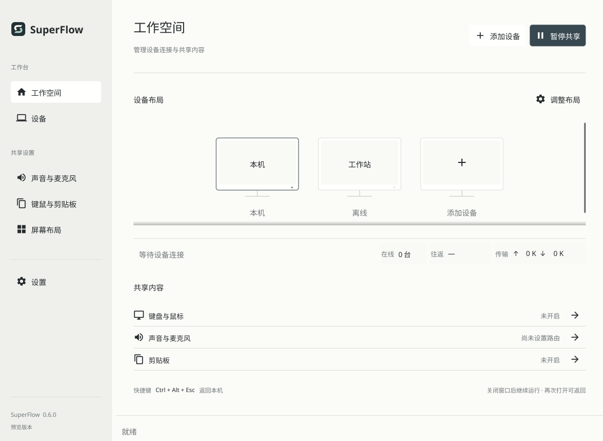

<p align="center">
  
</p>

<h1 align="center">One desk, many computers</h1>

<p align="center">
  Share sound, microphones, a keyboard, a mouse, and a text clipboard across macOS, Windows, and Linux.
</p>

<p align="center">
  <a href="https://github.com/xavier-chen/superflow/releases/tag/v0.7.0-alpha">Download</a> ·
  <a href="#quick-start">Quick start</a> ·
  <a href="#platforms">Platforms</a> ·
  <a href="docs/GO.md#网络设计">Network design</a> ·
  <a href="#简体中文">简体中文</a>
</p>

SuperFlow is a Go desktop app for people who work across several computers. Move your pointer to the edge of one screen to continue on another, copy text between machines, and listen to system audio from multiple computers through one set of speakers. Microphone sharing has its own controls and starts only when you enable it.

<p align="center">
  
</p>

| On your desk | In SuperFlow |
| --- | --- |
| **Keyboard and mouse** | Arrange computers in a drag-and-drop layout, cross screen edges, and return to your local computer with `Ctrl+Alt+Esc`. |
| **System audio and microphone** | Mix system audio from multiple sources with per-device volume. Route a microphone independently when you need it. |
| **Text clipboard** | Copy and paste UTF-8 text across paired computers. The clipboard already on a machine stays local when it connects. |
| **Connections and tray** | Pair with one invitation, reconnect automatically, and manage sharing from the tray. Reopen the app to return to your existing window. |

<details>
<summary>How SuperFlow sends data</summary>

A single QUIC connection carries separate reliable streams for input and clipboard traffic. Pointer motion and audio use datagrams. Pairing pins the hub's TLS certificate, and authenticated devices can join the screen layout automatically. Audio uses Opus when the selected devices support it, with a PCM fallback.

</details>

## Quick start

The desktop app supports **English and Simplified Chinese**. It follows your system language by default. Change it in the welcome screen or under **Settings → Language**. The interface updates immediately while your devices stay connected.

Download the desktop package for your operating system from [GitHub Releases](https://github.com/xavier-chen/superflow/releases/tag/v0.7.0-alpha).

Build the desktop app with **Go 1.26+** and your platform's graphics toolchain. The same command packages the native desktop build on each OS.

```sh
go run ./cmd/superflow-build --desktop
```

Open the resulting app and pair your computers:

1. On the computer with your keyboard and mouse, select **Use this keyboard and mouse** and copy its connection invitation.
2. On the other computer, select **Connect to another computer**, paste the invitation, and connect. SuperFlow fills in addresses and places the computer in your layout.
3. Enable the audio routes you need. Turn on system audio sharing on the source and audio playback on the destination. Enable microphone sharing separately.

Under **Settings**, you can install SuperFlow into your application menu and optionally start it in the background at sign-in.

## Platforms

| Platform | Desktop output | Setup notes |
| --- | --- | --- |
| **macOS** | `dist/SuperFlow.app` | Build with Xcode Command Line Tools. Grant Accessibility and, on the host, Input Monitoring. System audio capture and use of a remote mic in other apps require a virtual audio device. |
| **Windows** | `dist/SuperFlow-windows-<arch>.zip` | Build with MinGW, then open `SuperFlow.exe`. System audio capture uses WASAPI loopback. |
| **Linux** | `dist/SuperFlow-linux-<arch>.tar.gz` | Build with a C compiler and OpenGL/X11 development libraries. The desktop app uses X11 or Xwayland. Input sharing can require access to evdev and uinput devices. |

**0.7.0-alpha** targets Apple Silicon, Windows x64, and Linux x64/ARM64. Linux tray behavior and clipboard were tested in isolated graphical sessions. Windows packaging checks passed. Windows hardware, broader Wayland support, and sign-in behavior on real desktops still need validation.

For headless use, `go run ./cmd/superflow-build --all` builds the Go core for six OS and architecture combinations. The desktop app uses Fyne and requires Cgo at build time. The headless core builds with `CGO_ENABLED=0`.

[Setup and configuration](docs/GO.md) · [Test results](docs/GO-TESTING.md) · [Desktop test harness](tests/desktop/README.md)

## Acknowledgments

Thanks to the maintainers and contributors of Fyne, quic-go, Opus, and the open-source projects behind SuperFlow. [Open-source credits](ACKNOWLEDGMENTS.md)

---

## 简体中文

SuperFlow 是一款用 Go 开发的跨平台桌面工具。在同一张桌子上，用一套键鼠操作多台电脑，跨设备复制文本，把系统声音汇集到一处，或按需共享麦克风。支持 macOS、Windows 和 Linux。

- **键鼠与屏幕布局**支持拖拽排列设备、屏幕边缘切换和 `Ctrl+Alt+Esc` 返回本机。
- **声音与麦克风**可以独立设置。多路系统声音支持混音和单独调节音量。
- **文本剪贴板**在已配对的设备间同步。首次连接时，已有剪贴板内容保留在本机。
- **托盘与连接**支持一份邀请配对、自动重连和后台共享。关窗后重新打开应用，即可回到原窗口。

### 快速开始

界面支持**英文和简体中文**，默认跟随系统。首次启动或在 **设置 → 界面语言** 手动切换，当前共享连接会继续运行。

可在 [GitHub Releases](https://github.com/xavier-chen/superflow/releases/tag/v0.7.0-alpha) 下载对应系统和架构的桌面包。

安装 **Go 1.26+** 和对应系统的图形开发工具链，在项目根目录运行：

```sh
go run ./cmd/superflow-build --desktop
```

打开 `dist/` 中生成的桌面包。Mac 直接打开 `SuperFlow.app`，Windows 解压后打开 `SuperFlow.exe`，Linux 解压后运行 `./superflow`。

1. 在接着键鼠的电脑选择 **使用这台电脑的键盘和鼠标**，完成向导后复制连接邀请。
2. 在另一台电脑选择 **连接另一台电脑**，粘贴邀请并连接。地址和初始屏幕布局会自动填写。
3. 在声音来源端选择 **共享本机系统声音**，在收听端选择 **声音汇集到本机**。需要时再单独开启麦克风。

在 **设置** 可安装到当前用户的应用菜单、开启登录后后台启动、检查系统权限。Mac 键鼠需要辅助功能和输入监控权限，Linux 键鼠可能需要设备访问权限。Mac 系统声音采集及把远端麦克风交给其他应用使用时，需要虚拟声卡。Wayland 键鼠仍为实验功能。

**当前版本为 0.7.0-alpha。** 桌面构建目标为 Apple Silicon、Windows x64 和 Linux x64/ARM64。Linux 托盘和剪贴板通过隔离桌面会话验证，Windows 已通过打包检查。Windows 真机、更多 Wayland 桌面及真实登录启动仍待验证。

[完整配置与平台要求](docs/GO.md) · [测试记录](docs/GO-TESTING.md) · [开源致谢](ACKNOWLEDGMENTS.md#开源致谢)

---

Brand assets / 品牌素材 · [App icon](docs/assets/app-icon.svg) · [Documentation logo](docs/assets/superflow-logo.svg)
